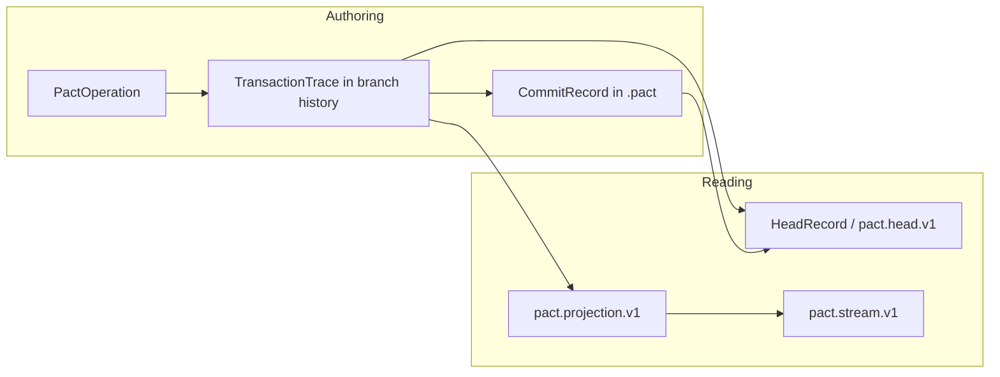
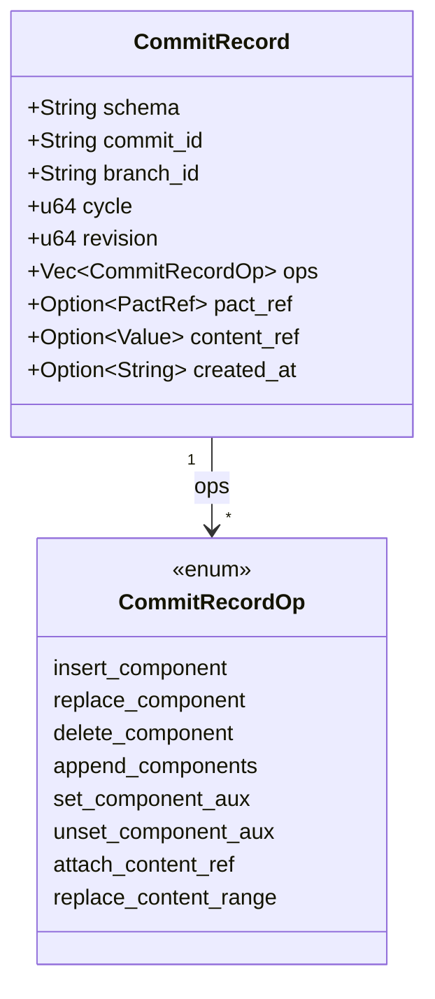
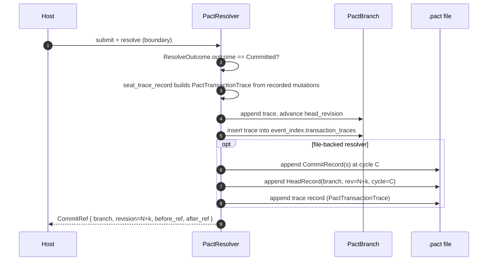
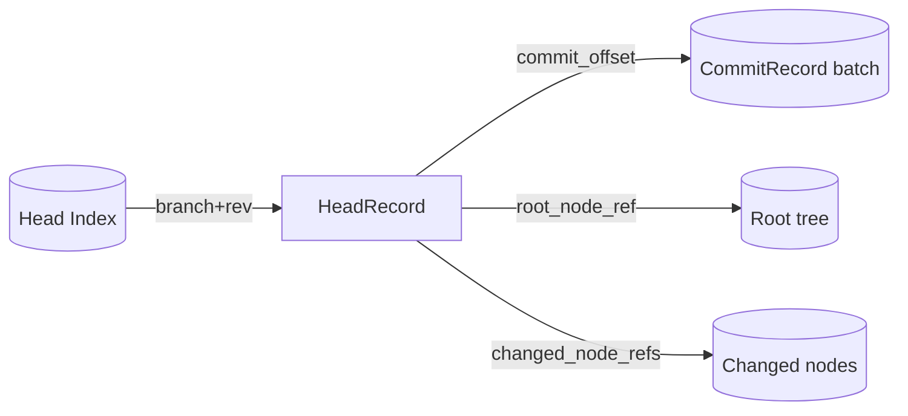
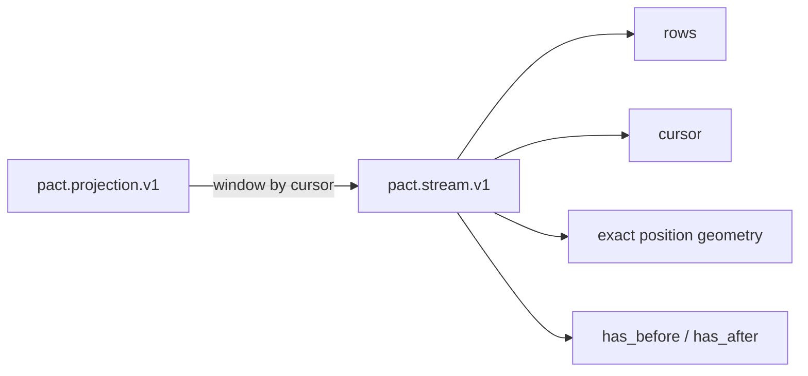
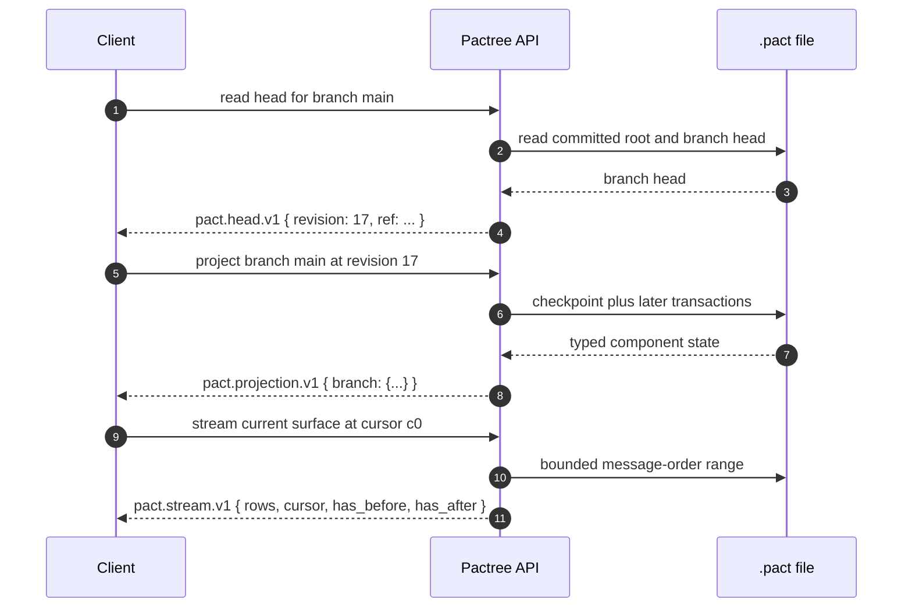

# Commit, Head, Projection, And Stream

Four concepts get conflated easily. Pactree treats them as distinct and they
sit at different levels of the substrate. This doc nails down the differences
and the data they carry.



- **Commits** persist a batch of branch changes at a revision/cycle.
- **Heads** are point-in-time summaries used to *locate* a revision.
- **Projections** are the canonical state envelope: branch view + filters.
- **Streams** are cursor windows over projection-derived rows.

## Commit

A commit is the durable record of one or more applied operations. Two
representations exist:

1. In the JSON store: each commit advances `branch.head_revision`, appends a
   transaction trace to branch history, and writes a `PactTransactionTrace`
   into `event_index.transaction_traces` by the resolver's
   `seal_trace_record`.
2. In `.pact` files: the same commit lands as one or more component-shaped
   `CommitRecord` entries (schema `pact.commit_record.v1`) followed by a
   `HeadRecord`, plus a durable trace record carrying the same
   `PactTransactionTrace`.

Mutations are the upstream artifact in both forms: the same
`recorded_mutations` list seeds the `PactTransactionTrace` and component-shaped
file commit records. The CLI's `root-record-transaction` is a side-door for
ingesting traces produced outside this pipeline. See
[`architecture/substrate-model.md`](substrate-model.md#from-mutations-to-transaction-traces)
for the full mutation → trace chain and the
[Two Layers Of Traces](substrate-model.md#two-layers-of-traces) table for
the resolver-trace vs transaction-trace distinction.

### CommitRecord Shape



The op set is intentionally finer-grained than the host-facing operation
surface. File-format commits can express targeted sub-operations
(`set_component_aux`, `replace_content_range`) while staying in component
vocabulary.

### Commit Sequence



`cycle` groups commits that share a logical pass (e.g., a single boundary's
worth of work). It is monotonic per file.

## Head

A **head** is the fast pointer to a branch at a revision. Two forms:

### `pact.head.v1` (JSON read API)

Returned by `pactree head` and `file_head_json`. Carries:

| Field            | Description                                          |
|------------------|------------------------------------------------------|
| `file_path`      | path to the `.pact` file (absent for in-memory).     |
| `file_kind`      | hot / archive / debug.                               |
| `root_id`        | logical root id.                                     |
| `branch_id`      | branch the head describes.                           |
| `current_branch` | the active branch in `ContextTreeLedger`.                |
| `revision`       | effective revision at this head.                     |
| `transaction_id` | last associated transaction, if any.                 |
| `pact_ref`       | `PactRef(root_id, branch_id, revision)`.             |
| `record_count`   | total records in the file (file heads only).         |
| `node_count`     | components visible in the projected view.            |

### `pact.head_record.v1` (durable file record)

Stored in the `.pact` stream as a `HeadRecord`. Carries:

- `branch_id`, `revision`, `cycle`
- `commit_offset` — byte offset where the commit batch ends
- `root_node_ref` — reference to the projected root for this head
- `changed_node_refs` — refs touched by this batch (for incremental readers)
- `content_ref_ids` — content refs introduced or replaced
- `record_seq` — file-wide sequence id

`HeadRecord` is what indexes point at; head lookups don't scan the whole
file, they jump straight to the index entry.



## Projection

`pactree project` and `file_projection_json` return `pact.projection.v1` —
the canonical envelope for "give me this branch at this revision":

```json
{
  "schema": "pact.projection.v1",
  "branch_id": "main",
  "revision": 4,
  "filters": { "view": null, "component_id": null },
  "branch": { /* projected PactBranch state */ },
  "components": [],
  "component_transactions": []
}
```

- `branch` holds the projected branch view at `revision` (a structure
  shaped like `PactView` plus selected metadata).
- `filters` records the projection filters applied at read time.
- `components` / `component_transactions` are present for forward
  compatibility. PACT v0 rejects component snapshot append APIs; live
  component registries are **not** persisted as hot Pact storage.

Projections are stateless reads. The same `(branch_id, revision)` always
yields the same projection.

## Stream

A **stream** is a cursor window over a projection. It is not the same thing
as a projection — projections give you full state at a revision, streams
give you a row window with explicit position geometry.



`ContextTree::stream` and `file_stream_json` return `pact.stream.v1` with:

- `rows` — ordered row payloads (from the projection's `message_order`).
- `cursor` — opaque cursor token marking the current read position.
- `has_before` / `has_after` — whether more rows exist on either side.
- Exact position geometry (offsets / ids) for resumable reads.

Two well-known surfaces are exposed:

- `current_surface` — rows describing the projected state at the cursor.
- `activity_surface` — rows describing the delta since the cursor.

See the [stream contract](../reference/stream-contract.md) for row schemas
and cursor semantics.

## Putting It Together

A complete read-side flow:



`head` → "where am I?"\
`projection` → "what is the full state here?"\
`stream` → "give me a window of rows from here."

## Source Anchors

- `src/resolver.rs`, `src/resolver/commit.rs` — commit lifecycle
- `src/store/model.rs` — `TransactionTrace`, `PactBranch.head_revision`
- `src/file_format.rs`, `src/file_format/wire.rs`,
  `src/file_format/history.rs` — `CommitRecord`, `HeadRecord` encoding
- `src/main.rs` — `head` / `project` / `stream` CLI handlers
- [`reference/stream-contract.md`](../reference/stream-contract.md) — row
  schema and cursor semantics
