# Pactree Substrate Model

> **Vocabulary.**
> - **`ContextTreeLedger`** — the durable ledger: commits/history/content refs +
>   the current head pointer (`store::model::ContextTreeLedger`).
> - **`Head`** — *invoking* the current sealed point of the ledger
>   (`resolver.head()`); it **yields a `PactView`**.
> - **`PactView`** — the view/projection payload, reached via `head()` or a
>   projection.
> - **`ContextTree`** — the *transient working-view object* (the pactree-py
>   facade): mutate helpers (`insert/append/select/send/recieve`) over staged
>   state; committing yields a new `ContextTree`. Logically still a view of the
>   current tree.
> - Hard forks create a new ledger; soft forks use an overlay.

Pactree is a deterministic context-tree substrate. "Substrate" means it owns the
data model, the operations on that model, the storage of that model, and the
projections out of it — but it does **not** own host UI, agent policy, or
provider wire formats. Host applications adapt Pactree output; they do not get
to redefine its semantics.

This document is the entry point to the architecture. It explains how the in-
memory model, the storage model, and the boundary surfaces fit together.

## The Substrate And Its Storage Form

Pactree is **one substrate** — a single conceptual model of nodes, stores,
branches, mutations, traces, and projections. The `.pact` file is **not a
second substrate**; it is the same substrate's binary on-disk form,
optimized for compact storage and fast loading.

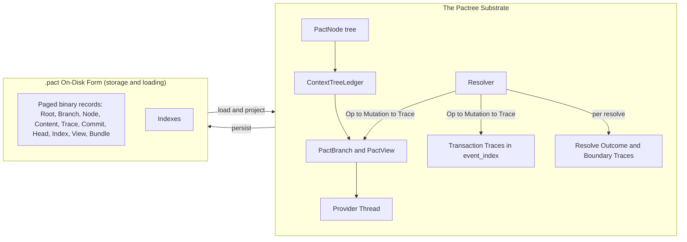

- **In-memory** (`src/components.rs`, `src/store/`, `src/resolver.rs`,
  `src/provider_thread.rs`): PACT components, branchable ledgers,
  transaction traces, content records, and provider-thread rendering.
- **On-disk `.pact`** (`src/file_format.rs`, `src/file_format/*`): the same
  substrate encoded as a paged, append-oriented binary stream of root,
  branch, node, content, trace, commit, head, index, view, and bundle
  records. It is a **storage representation**, not a separate model — every
  on-disk record projects back into the same Rust types it came from.

The Rust crate is the authority. The CLI (`src/main.rs`) mostly wires JSON
stdin/stdout to those Rust APIs.

## Node Tree

The basic unit is `PactNode` (`src/node.rs`). A node is more than a string of
text — it is a typed, ordered, addressable participant in a tree. The complete
field reference lives in [`reference/node-model.md`](../reference/node-model.md);
the shape at a glance:

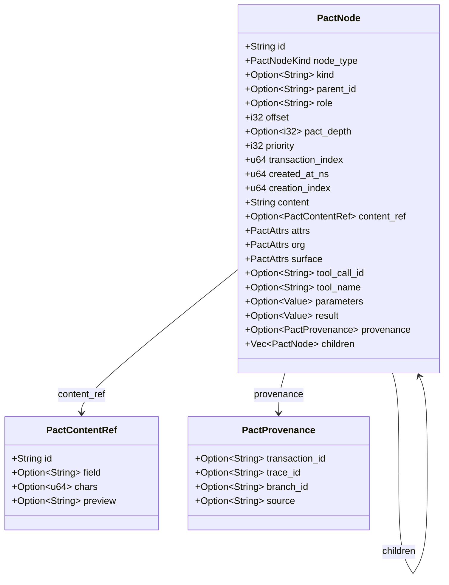

### Canonical Node Kinds

`CanonicalNodeKind` (`src/node.rs`) defines a small fixed vocabulary of node
types. Every other shape is an extension carried by ordinary node fields — the
substrate is not extended by adding new variants.

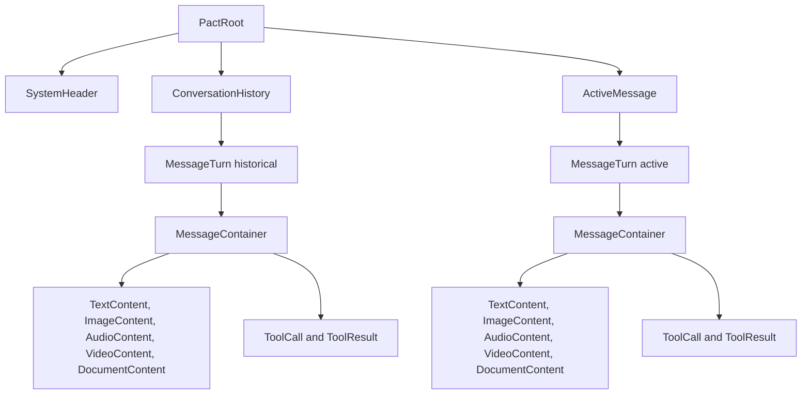

`PactNode` (the kind named after the struct) is reserved as an extension
escape hatch — it lets a host carry custom payload without inventing a kind.

### Deterministic Child Ordering

Children are sorted recursively by a 5-tuple key:

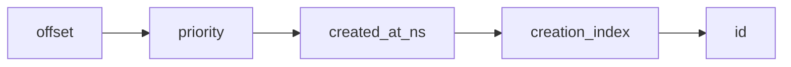

Two extra rules apply at specific points in the tree:

- **Root regions** rank `SystemHeader` (0), `ConversationHistory` (1),
  `ActiveMessage` (2), then everything else (3) — so the macro layout is
  stable even when offsets disagree.
- **`ConversationHistory` children** are first sorted by `-pact_depth` so the
  oldest historical turn (most negative `pact_depth`) lands earliest.

`pact_depth` is **narrative depth**, not tree depth: `0` is the active turn,
positive values are historical (older = more positive), negative values are
system/setup material. Tree depth (geometric distance from the root) is
computed separately during normalization (`src/normalize.rs`).

### Content: Inline vs Ref

Each `PactNode` can carry payload inline (`content: String`) or by reference
(`content_ref: Option<PactContentRef>`). `PayloadSlotPolicy`
(`src/node.rs`) governs externalization per field:

| Slot           | Provider-visible | Source required | Notes                       |
|----------------|------------------|-----------------|-----------------------------|
| `$.content`    | yes              | no              | default text payload        |
| `$.media_content` | yes           | yes             | binary media                |
| `$.data`       | yes              | yes             | binary blobs                |
| `$.parameters` | yes              | no              | tool call args              |
| `$.result`     | yes              | yes             | tool result payload         |
| `$.surface`    | yes              | no              | provider-visible surface    |
| `$.attrs`      | no               | no              | host metadata               |
| `$.org`        | no               | no              | org-internal metadata       |
| `$.aux`        | no               | no              | trace-only metadata         |

Defaults: inline up to **1024 bytes**, with a **160-character preview** when
externalized. Above the limit, the resolver stamps the node with a
`PactContentRef` pointing into the `ContentStore`.

## JSON Store

`ContextTreeLedger` (`src/store/model.rs`) is the branchable JSON model that holds
every branch for a single logical document/session:

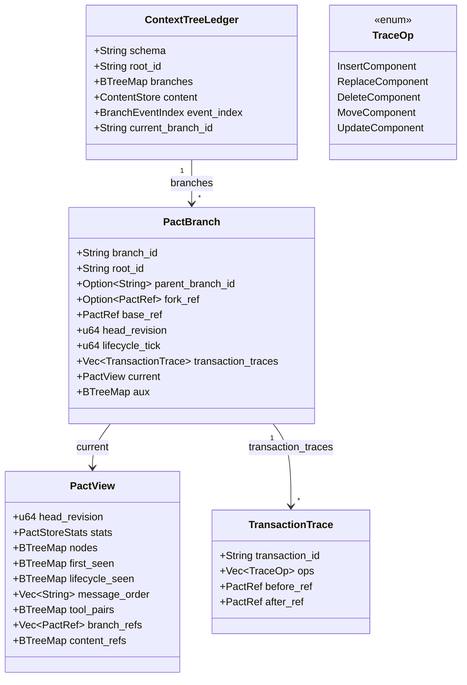

A branch is a **timeline**: an immutable `base_ref` snapshot plus an ordered
log of transaction traces. Each committed boundary advances the branch
`head_revision`; trace records carry the resolved component operations and
boundary refs for replay and audit.

`PactView` is the projected view of the branch at its head:

- `nodes` — flat `id → NodeRecord` map (denormalized tree).
- `first_seen` — node id → the revision in which it first appeared.
- `lifecycle_seen` — node id → last-touched revision (used by stream activity).
- `message_order` — ordered ids used by the streaming surface.
- `tool_pairs` — `tool_call_id → {call_ids, result_ids}` for pair-aware delete.
- `content_refs` — summaries of `ContentStore` entries reachable from the view.

`BranchEventIndex` (`src/store/model.rs`) maintains denormalized indexes for
fast lookup by transaction, role, component type, and `aux` key.

### Trace Ops

Transaction traces are the durable replay vocabulary:

| `op`              | Required fields                       | Effect                       |
|-------------------|---------------------------------------|------------------------------|
| `InsertComponent` | target, component payload             | append component under parent |
| `UpdateComponent` | target, component field updates       | mutate component in place    |
| `ReplaceComponent`| target, component payload             | swap component payload       |
| `MoveComponent`   | target, new parent/position           | move component subtree       |
| `DeleteComponent` | target                                | drop component subtree       |

Traces are append-only runtime history. Removed patch-shaped history is rejected
rather than treated as a second replay vocabulary.

## Operations And Mutations

The substrate distinguishes three artifacts along the mutation pipeline:

1. **Operations** (`PactOperation`, `src/ops.rs`) — what the host *intends*.
2. **Mutations** (`MutationRequest`, `src/mutation.rs`) — the resolver's
   internal mechanical form. **Mutations are the unit that gets traced.**
3. **Transaction traces** (`TransactionTrace` / `TraceOp`) — the durable,
   replayable form written into branch history and file trace records.

A `PactTransactionTrace` is built from the recorded mutations at a commit
boundary. Removed patch-shaped inputs are rejected, not migrated.

### Operations

`PactOperation` is the small, well-typed set of host-visible primitives. The
substrate prefers a closed vocabulary over a sprawling DSL:

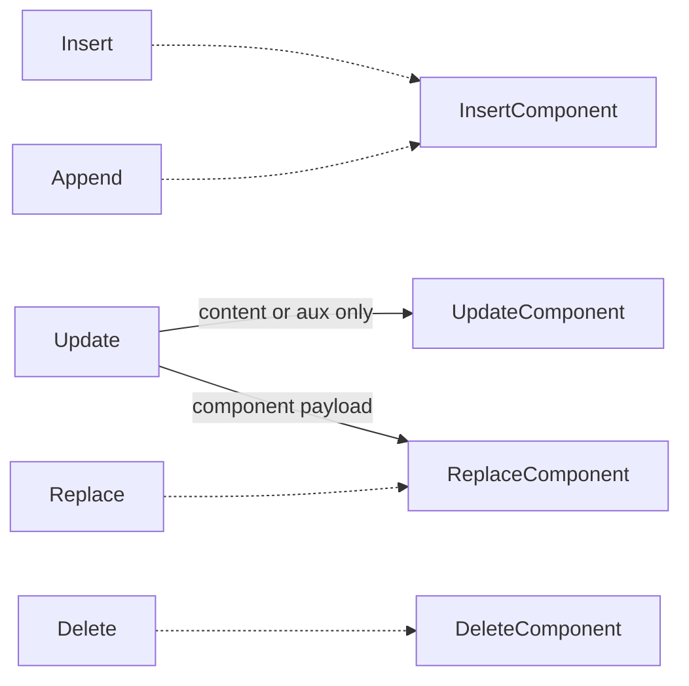

Every operation carries a `PactOperationEnvelope` with `branch_id`, a
`SourceActor` (User / Assistant / Host / System), an optional
`idempotency_key`, a host timestamp, and free-form `aux` metadata. The
resolver dedupes on `(branch_id, idempotency_key)` so retries are safe.

Higher-level host intents (adding a message, editing user text, streaming an
assistant delta) lower to these five primitives before entering the resolver.
That keeps the substrate's mutation vocabulary closed.

### Mutations

`MutationRequest` (`src/mutation.rs:76`) is the resolver-internal form. The
resolver lowers each `PactOperation` to one or more `MutationRequest`s via
`op_to_mutations(op, &tree)`, which is the only place that knows how to
resolve selectors, infer parent/depth from tree position, pair tool calls
with results, prune hollow turns, and so on.

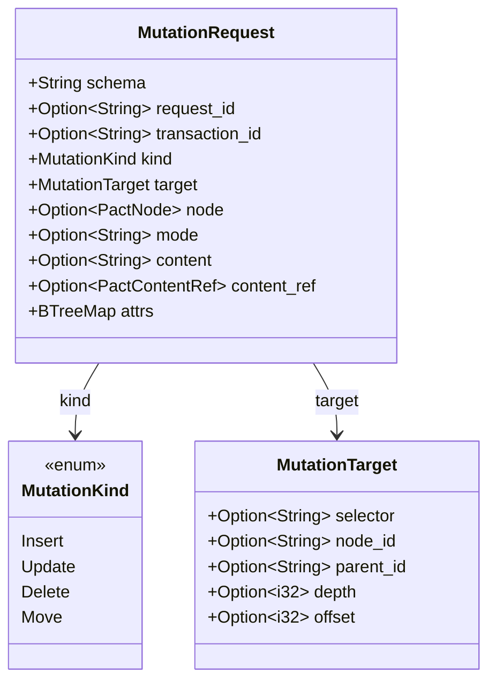

Key properties of a `MutationRequest`:

- **It carries `transaction_id` natively** — mutations know which
  transaction they belong to before they ever touch a branch.
- It is the only thing the native mutation engine accepts. The staged tree
  only ever moves through mutations.
- **It is the upstream of transaction traces.** On commit, the resolver folds
  the recorded mutation list into a `PactTransactionTrace`.

This is why mutations — not operations — are what the substrate's trace
machinery is built around. Operations are the host-facing surface;
mutations are the substrate's verb.

### Resolver Lifecycle

The resolver (`src/resolver.rs`, `src/resolver/lifecycle.rs`) is a small state
machine sitting between an operation source and a branch:

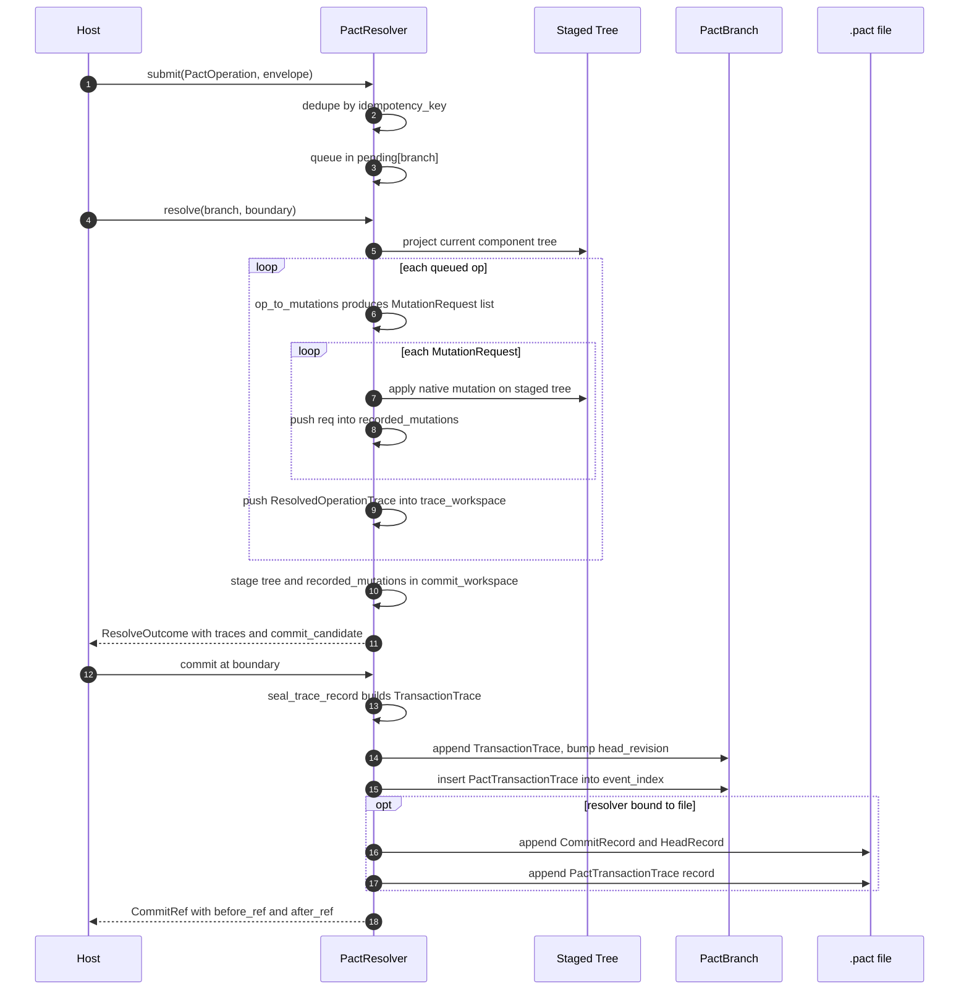

`ResolveOutcome` (`src/trace.rs`) is the canonical result of a resolve pass:
applied op kinds, rejected ops with reasons, dirty projections, per-op
`ResolvedOperationTrace`s, any pending external mutations, a
`BoundaryOutcome` (`Committed` / `Deferred` / `WaitingExternal` / `Failed`),
and a `commit_candidate: ResolvedBoundary` carrying the boundary's
`before_ref` and `after_ref`.

### From Mutations To Transaction Traces

Operations are not what gets traced — **mutations are**. The resolver's
commit pipeline lowers each `PactOperation` to one or more
`MutationRequest`s (each carrying a `transaction_id`), applies them to a
staged tree, and on commit folds the recorded mutations into both durable
forms:

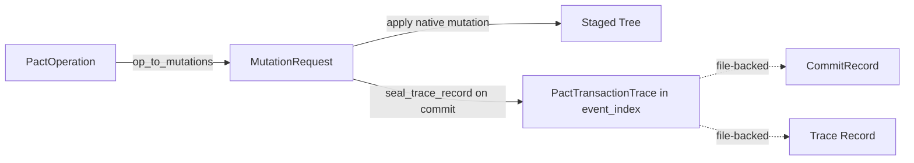

So `PactTransactionTrace` is the resolver's durable summary of the
mutations applied during one boundary's commit. File commit records are a
serialized adapter over the same component-shaped operation vocabulary.

### Two Layers Of Traces

The substrate keeps two distinct trace records, both produced by the
resolver but at different layers and with different lifetimes:

| Trace                                                             | Layer     | Lifetime                              | Where it lives                          | Built by                                                                                                       |
|-------------------------------------------------------------------|-----------|---------------------------------------|-----------------------------------------|----------------------------------------------------------------------------------------------------------------|
| `ResolvedOperationTrace`, `ResolvedBoundary` (in `ResolveOutcome`) | Resolver  | One per `resolve()` call (one boundary) | Returned from `resolve()`, staged in `trace_workspace` | Resolver, while resolving                                                                                      |
| `PactTransactionTrace`                                            | Store     | One per resolved boundary commit (assembled from per-cycle boundary refs as the cycle progresses) | `branch.event_index.transaction_traces` | Resolver on commit, via `seal_trace_record` (auto). `root_store_record_transaction_trace_json` is a side-door for out-of-band recording. |

`PactTransactionTrace` (`src/store/model.rs:214`) holds a `PactRef` for each
boundary the cycle passed through:

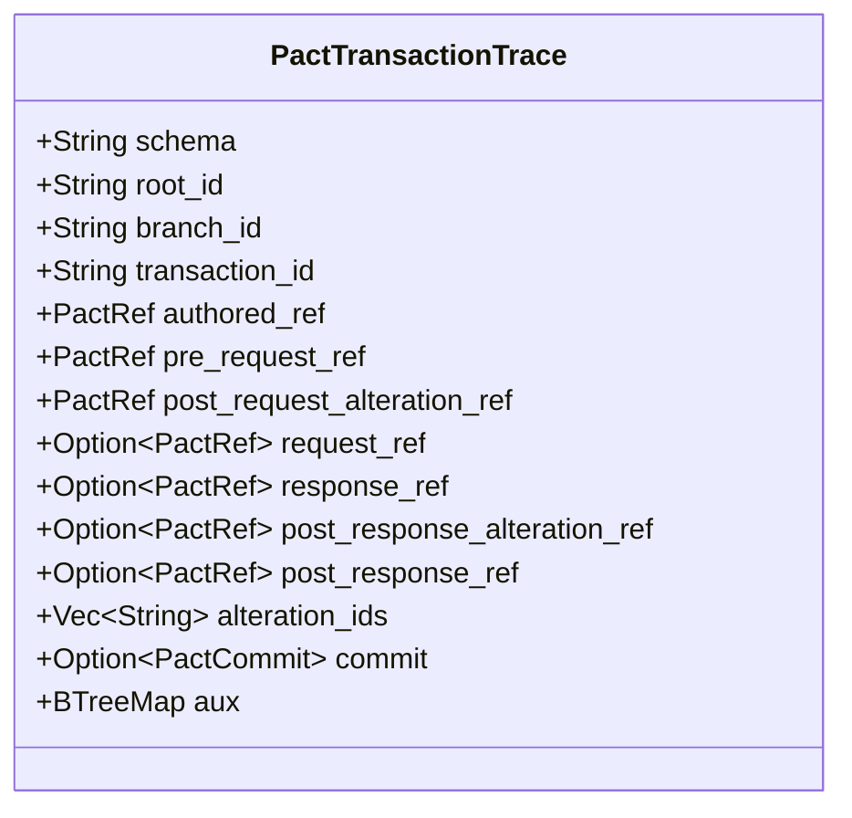

The first three boundary refs (`authored_ref`, `pre_request_ref`,
`post_request_alteration_ref`) are required; the rest become populated as
the cycle progresses through `request → response → post_response_alteration
→ post_response`. Each commit's `seal_trace_record` stamps the boundary it
just resolved into the appropriate slot, populates `alteration_ids` from
the boundary's `applied` op list, and writes the trace into
`event_index.transaction_traces` (`src/resolver/api.rs:763–852`). The
`root_store_record_transaction_trace_json` API exists for hosts that need
to record traces produced outside this pipeline.

### Boundary Kinds

Commits happen at named boundaries (`BoundaryKind`, `src/trace.rs`) so traces
are interpretable:

| Boundary                  | Meaning                                              |
|---------------------------|------------------------------------------------------|
| `Authored`                | freshly-authored content ready to land               |
| `PreRequest`              | before assembling an outbound provider request       |
| `PostRequestAlteration`   | post-prep tweaks (still pre-send)                    |
| `Request`                 | moment the request is sent                           |
| `Response`                | external response arrived                            |
| `PostResponseAlteration`  | response handling (e.g., tool execution)             |
| `PostResponse`            | final settled state                                  |
| `Adhoc`                   | out-of-band mutation                                 |

### File-Backed Commits

In `.pact` files, each committed change is encoded as a `CommitRecord`
(`pact.commit_record.v1`) carrying one of these op variants:
`insert_component`, `replace_component`, `delete_component`,
`append_components`, `set_component_aux`, `unset_component_aux`,
`attach_content_ref`, `replace_content_range`. After the commit batch, a
`HeadRecord` is written marking the new branch head.

## Head

A **head** is the fast summary of a branch at a revision. `file_head_json`
returns `pact.head.v1` carrying:

- file path and file kind
- root id and branch id (plus the active branch id)
- effective revision
- the associated transaction id, if any
- the `PactRef` for the head
- record and node counts

The binary format also has durable `HeadRecord` entries
(`pact.head_record.v1`) with branch id, head revision/cycle, commit offset,
root node ref, changed node refs, content ref ids, and record sequence ids.
Heads are how readers locate the right revision without scanning the whole
file.

## Projection

A **projection** is the Pactree-owned envelope returned by
`file_projection_json` and `pactree project`:

```json
{
  "schema": "pact.projection.v1",
  "branch_id": "main",
  "revision": 4,
  "filters": {"view": null, "component_id": null},
  "branch": {},
  "components": [],
  "component_transactions": []
}
```

The `branch` member is the projected branch view. Component arrays are
present for forward-compatibility, but PACT v0 rejects component snapshot
append APIs; live component registries are not persisted as hot Pact storage.

A projection is not a stream — see below.

## Stream

A **stream** is a cursor window over a projected surface. Code exposes
`current_surface` and `activity_surface` through `pact.stream.v1`, with
`has_before` / `has_after` flags and explicit position geometry. See the
[stream contract](../reference/stream-contract.md) for the row schema.

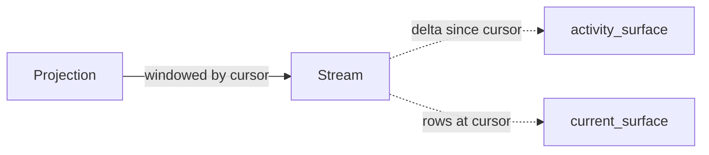

## View

`src/view.rs` defines typed view refs that decouple readers from the branch
they're reading:

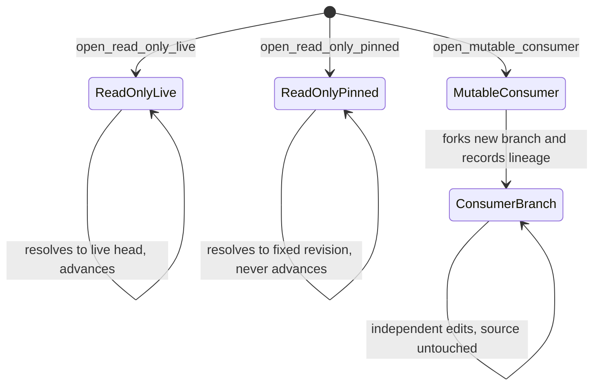

- `read_only_live` — always resolves to the source branch's current head.
- `read_only_pinned` — pins to a specific revision at open time.
- `mutable_consumer` — forks a consumer branch and records the source lineage
  in `aux.view`; consumer mutations land only on the consumer branch.

Views are branch-following primitives. They do not define host UI behavior.

## Projection

**Projection** is the read surface that reconstructs the requested view from
branch state or `.pact` records without exposing a separate public read
substrate.

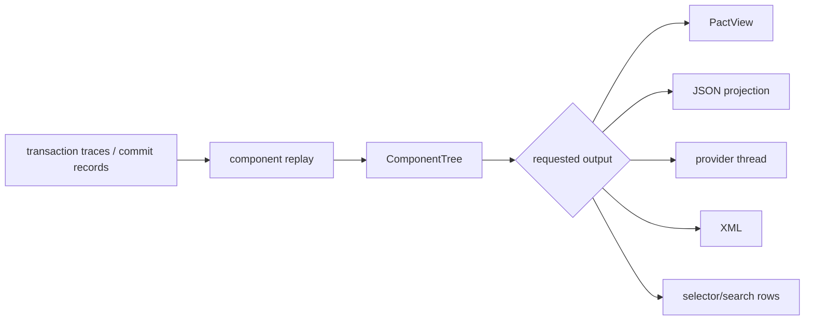

File projection validates the record stream, selects the target branch and
revision, and emits the requested projection sink.

## Source Anchors

- `src/components.rs` — `Component`, `ComponentKind`, `PayloadSlotPolicy`
- `src/store/model.rs` — `ContextTreeLedger`, `PactBranch`, `PactView`,
  `ComponentRecord`, `TransactionTrace`
- `src/store/api.rs` — store-level APIs
- `src/ops.rs` — `PactOperation` primitives + `PactOperationEnvelope`
- `src/mutation.rs` — `MutationRequest`, `MutationKind`, `MutationTarget`
- `src/resolver.rs`, `src/resolver/lifecycle.rs`,
  `src/resolver/api.rs` — submit / resolve / commit / `seal_trace_record`
- `src/trace.rs` — `BoundaryKind`, `ResolveOutcome`, `ResolvedBoundary`,
  `ResolvedOperationTrace` (resolver-layer traces)
- `src/store/model.rs` (`PactTransactionTrace`),
  `src/store/trace.rs` (build/validate) — store-layer transaction traces
- `src/provider_thread.rs` — provider-neutral message JSON
- `src/file_format.rs`, `src/file_format/*` — `.pact` page layout, records,
  indexes, materialization
- `src/view.rs` — view refs (`ReadOnlyLive`, `ReadOnlyPinned`,
  `MutableConsumer`)
- `src/main.rs` — CLI surface
