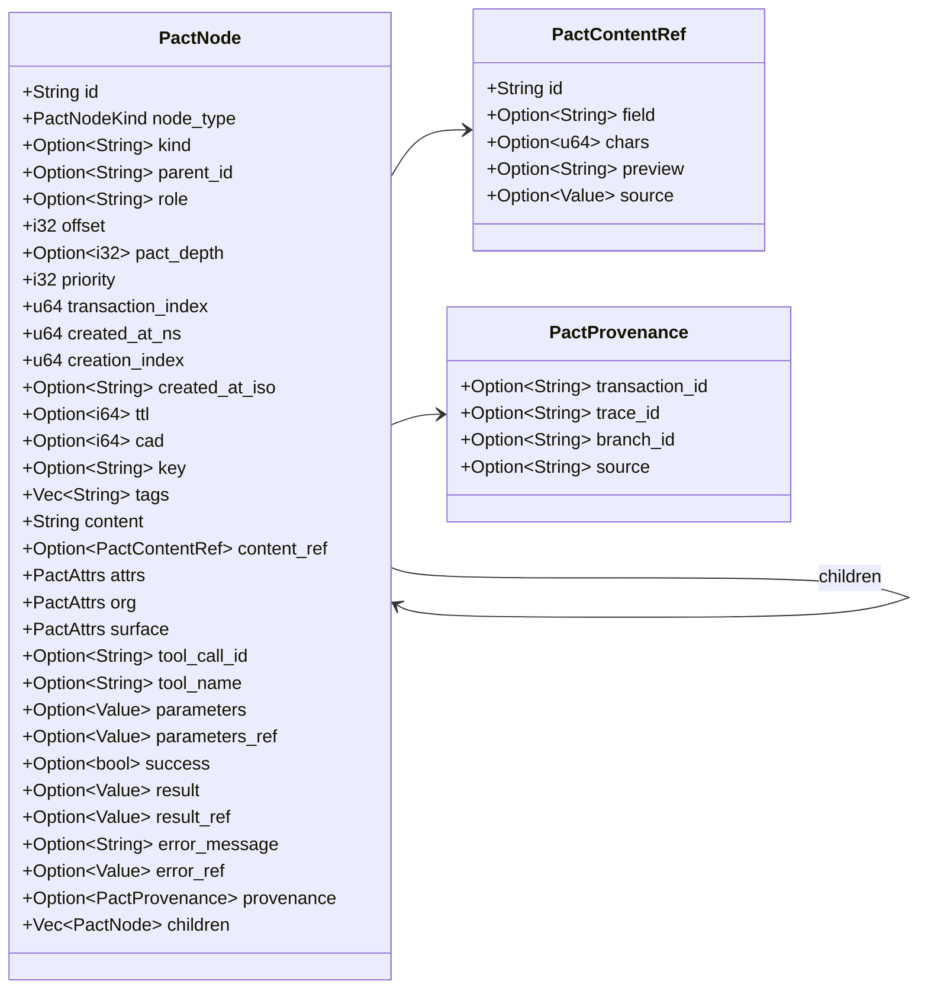
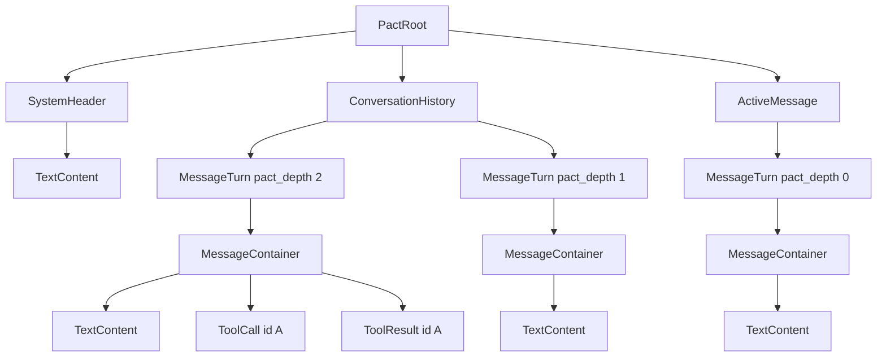
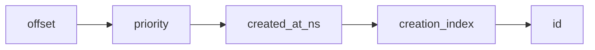
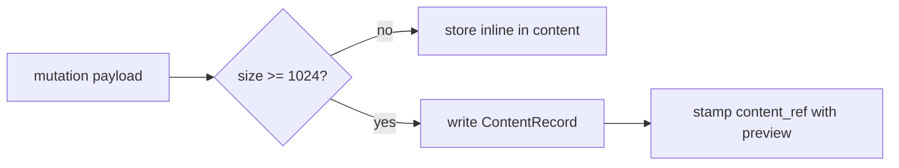

# Node Model Reference

`PactNode` (`src/node.rs`) is the unit of the Pactree substrate. This page is
the field-by-field reference. For how nodes assemble into the broader model,
see [`architecture/substrate-model.md`](../architecture/substrate-model.md);
for the denormalized form used inside `PactView`, see
`NodeRecord` in `src/store/model.rs`.

## Anatomy

## Field Reference

### Identity And Type

| Field        | Type                | Notes                                             |
|--------------|---------------------|---------------------------------------------------|
| `id`         | `String`            | Stable unique identifier within the tree.         |
| `node_type`  | `PactNodeKind`      | Discriminator; JSON `componentType` (`nodeType`/`type` accepted, transitional).|
| `kind`       | `Option<String>`    | Secondary discriminator (JSON `type`).            |

`node_type` is a canonical enum variant; `kind` is a free-form refinement
host code can use without inventing a new canonical kind.

### Tree Position

| Field            | Type             | Notes                                                            |
|------------------|------------------|------------------------------------------------------------------|
| `parent_id`      | `Option<String>` | Auto-inferred from tree position when absent.                    |
| `role`           | `Option<String>` | Semantic role (`user`, `assistant`, `system`, …).                |
| `offset`         | `i32`            | Sibling position; negative offsets precede positive ones.        |
| `pact_depth`     | `Option<i32>`    | **Narrative** depth, not tree depth. See below.                  |
| `priority`       | `i32`            | Sort tiebreaker within the same offset.                          |

`pact_depth` is the depth in the *conversation*: `0` is the active turn,
positive values are historical (more positive = older), negative values are
system/setup material. Tree depth (geometric distance from the root) is
computed during normalization and is a separate concept.

For a top-level turn, `pact_depth` is its rank from the newest turn: every new
top-level turn makes every older turn one step deeper, and a turn's whole
subtree carries the turn's depth. A branch whose aux carries
`pact.depth.derived: true` stores no canonical depth updates at all; every
reader derives the same values from root order (the bounded append writer sets
that mark with `PactAppendOptions::derived_depth`). A branch without the mark
keeps replaying its recorded `SetField pact_depth` ops.

### Ordering And Lifecycle Metadata

| Field                | Type             | Notes                                              |
|----------------------|------------------|----------------------------------------------------|
| `transaction_index`  | `u64`            | Zero-indexed position within its transaction.      |
| `created_at_ns`      | `u64`            | Nanoseconds since UNIX epoch.                      |
| `creation_index`     | `u64`            | Disambiguates nodes created at the same `_ns`.     |
| `created_at_iso`     | `Option<String>` | Human-readable ISO 8601 timestamp.                 |
| `ttl`                | `Option<i64>`    | Advisory time-to-live in seconds; **not enforced**.|
| `cad`                | `Option<i64>`    | Cadence/heartbeat seconds; **not enforced**.       |
| `key`                | `Option<String>` | Client-supplied dedupe key.                        |
| `tags`               | `Vec<String>`    | Free-form tags; selector-matchable.                |

### Content

| Field         | Type                       | Notes                                       |
|---------------|----------------------------|---------------------------------------------|
| `content`     | `String`                   | Inline payload; defaults to empty.          |
| `content_ref` | `Option<PactContentRef>`   | Externalized payload reference.             |

`PactContentRef` resolves into the `ContentStore` carried by
`PactRootStore`. Hosts read either inline or hydrate from the store; see
[Content Refs And Bundles](content-refs-and-bundles.md).

### Escape-Hatch Maps

| Field     | Provider-visible | Purpose                                    |
|-----------|------------------|--------------------------------------------|
| `attrs`   | yes              | Host metadata that providers may see.      |
| `org`     | no               | Org-internal metadata.                     |
| `surface` | yes              | Presentation hints for UI surfaces.        |

All three are `BTreeMap<String, Value>` (`PactAttrs`). They are the only
sanctioned places to carry extension data without changing the canonical
schema.

### Tool Call / Result

| Field             | Type             | Notes                                                  |
|-------------------|------------------|--------------------------------------------------------|
| `tool_call_id`    | `Option<String>` | Pairs `ToolCall` with `ToolResult`.                    |
| `tool_name`       | `Option<String>` | Invoked tool/function name.                            |
| `parameters`      | `Option<Value>`  | JSON arguments (inline).                               |
| `parameters_ref`  | `Option<Value>`  | Reference to externalized parameters.                  |
| `success`         | `Option<bool>`   | Result status.                                         |
| `result`          | `Option<Value>`  | JSON result payload (inline).                          |
| `result_ref`      | `Option<Value>`  | Reference to externalized result.                      |
| `error_message`   | `Option<String>` | Human-readable failure reason.                         |
| `error_ref`       | `Option<Value>`  | Reference to externalized error.                       |

Pair invariants are enforced at mutation time: deleting a `ToolCall` also
deletes its paired `ToolResult` (and vice versa). The branch's `PactView`
maintains a `tool_pairs` map keyed by `tool_call_id`.

### Provenance

`PactProvenance` records mutation origin and is set at node creation. The
fields are all optional but together identify "who created this node where":

- `transaction_id` — which transaction.
- `trace_id` — which boundary trace.
- `branch_id` — which branch.
- `source` — `user` / `assistant` / `host` / `system`.

### Children

`children: Vec<PactNode>` carries the recursive tree. Children are stored
ordered; insertion APIs are responsible for assigning offsets such that the
ordering rules below remain stable.

## Canonical Node Kinds

`CanonicalNodeKind` is a fixed enum. The substrate is **closed** to new
variants; extensions live in `attrs` / `org` / `surface` instead.

| Variant             | JSON node type        | Purpose                                |
|---------------------|-----------------------|----------------------------------------|
| `PactNode`          | `PACTNode`            | Extension escape hatch.                |
| `PactRoot`          | `PactRoot`            | The tree root.                         |
| `SystemHeader`      | `SystemHeader`        | System / setup region (`pact_depth<0`).|
| `ConversationHistory` | `ConversationHistory` | Container for historical turns.       |
| `ActiveMessage`     | `ActiveMessage`       | Container for the active turn.         |
| `MessageTurn`       | `MessageTurn`         | A single turn (any role).              |
| `MessageContainer`  | `MessageContainer`    | Groups content blocks inside a turn.   |
| `TextContent`       | `TextContent`         | Text leaf.                             |
| `ImageContent`      | `ImageContent`        | Image leaf.                            |
| `AudioContent`      | `AudioContent`        | Audio leaf.                            |
| `VideoContent`      | `VideoContent`        | Video leaf.                            |
| `DocumentContent`   | `DocumentContent`     | Document leaf.                         |
| `ToolCall`          | `ToolCall`            | Outbound tool invocation.              |
| `ToolResult`        | `ToolResult`          | Inbound tool response.                 |

The parser accepts case-insensitive snake_case aliases (`root`,
`message_turn`, `text_content`, …) for canonical kinds.

### Typical Tree Shape

## Ordering

Children sort by a 5-tuple key, evaluated lexicographically:

### Root-region rule

At the root, canonical kinds are ranked before the standard sort:

| Rank | Kind                  |
|------|-----------------------|
| 0    | `SystemHeader`        |
| 1    | `ConversationHistory` |
| 2    | `ActiveMessage`       |
| 3    | everything else       |

This guarantees the macro layout even when offsets disagree.

### ConversationHistory rule

Children of `ConversationHistory` are sorted by `-pact_depth` first (so the
oldest historical turn — most negative `pact_depth` — lands earliest), then
by the standard 5-tuple key.

## Content Externalization

`PayloadSlotPolicy` (`src/node.rs`) selects which fields can be externalized
into the `ContentStore` and under what conditions. The defaults are:

| Slot             | Provider-visible | Source required |
|------------------|------------------|-----------------|
| `$.content`      | yes              | no              |
| `$.media_content`| yes              | **yes**         |
| `$.data`         | yes              | **yes**         |
| `$.parameters`   | yes              | no              |
| `$.result`       | yes              | **yes**         |
| `$.surface`      | yes              | no              |
| `$.attrs`        | no               | no              |
| `$.org`          | no               | no              |
| `$.aux`          | no               | no              |

Thresholds: `DEFAULT_PAYLOAD_INLINE_LIMIT_BYTES = 1024`,
`DEFAULT_PREVIEW_INLINE_LIMIT_BYTES = 160`. Payloads at or above the limit
move into `ContentStore`; the node is stamped with a `PactContentRef`
containing an id, optional JSON `field` path, character count, and a
preview.

## NodeRecord vs PactNode

`NodeRecord` (`src/store/model.rs`) is the denormalized form inside a
`PactView`:

- It is **flat** — child structure is held as `child_ids: Vec<String>`
  rather than a recursive `children` vector. The tree is reconstructed by
  walking ids on read.
- It carries the same identity, position, content, tool, and provenance
  fields, plus a precomputed `content_preview` when applicable.
- It is the form streams and projections read from.

`PactNode` is the wire and authoring form; `NodeRecord` is the index form.

## Source Anchors

- `src/node.rs` — `PactNode`, `CanonicalNodeKind`, `PactContentRef`,
  `PactProvenance`, `PayloadSlotPolicy`
- `src/store/model.rs` — `NodeRecord`, `ToolPairRecord`,
  `ContentRecordSummary`
- `src/normalize.rs` — depth computation, sort enforcement, schema rejection
